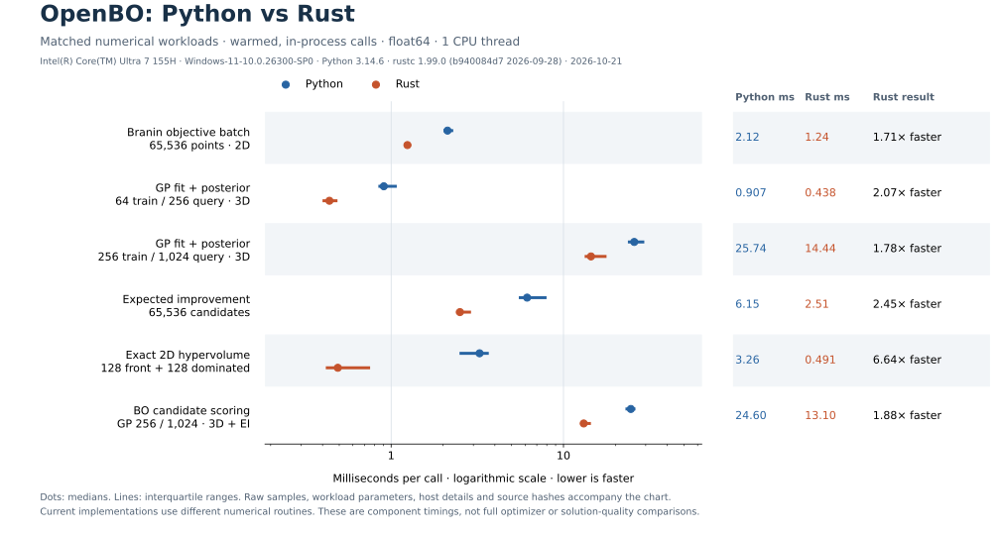
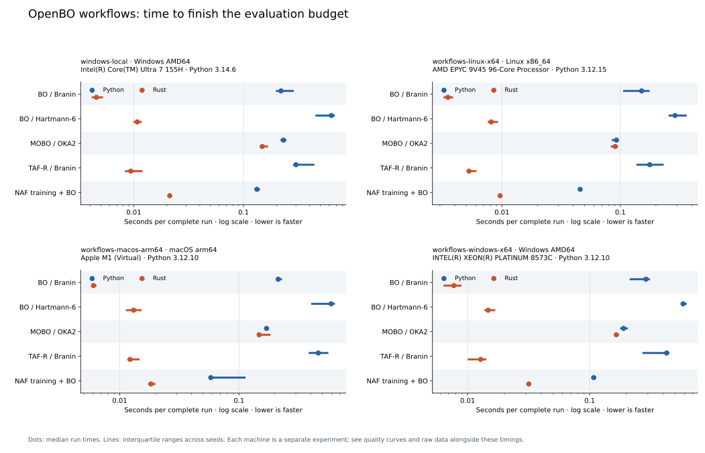
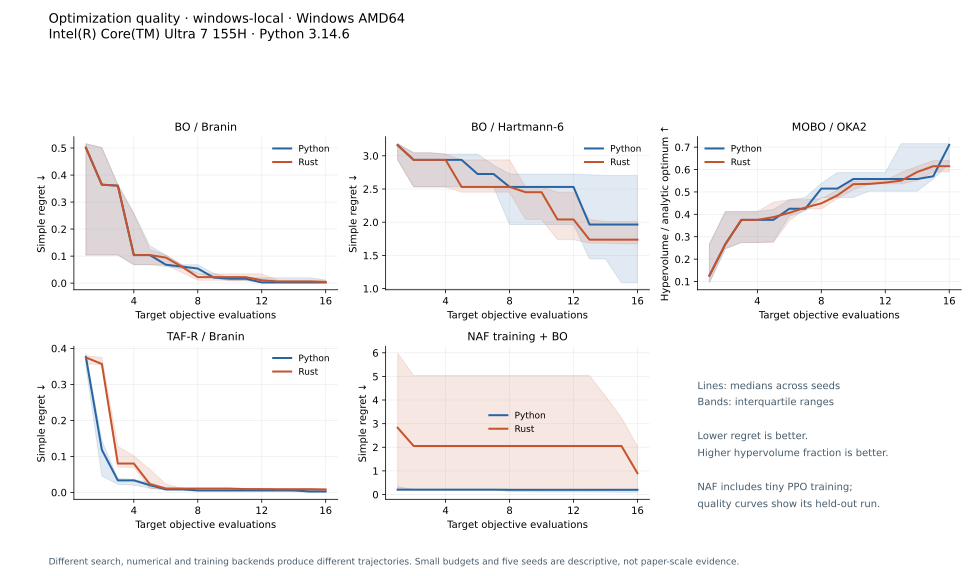

# OpenBO Rust

A standalone Rust library and command-line package for Bayesian optimization,
transfer learning, continual optimization and multi-objective experiments. It uses
double-precision CPU linear algebra with no Python, PyTorch or libtorch runtime
dependency.

The Cargo package is `openbo-rust`; its library and command are both named
`openbo`. It is derived from [OpenBO](https://github.com/yichiliao/openbo) revision
`3ceda2d`. Attribution, coverage and numerical differences are in
[PORTING.md](PORTING.md).

Start with the [student guide](https://m-colley.github.io/openbo-rust/) or browse
the [public API reference](https://m-colley.github.io/openbo-rust/openbo/).

## First experiment

Install a [Rust toolchain](https://www.rust-lang.org/tools/install), version 1.85
or newer. On Windows, use the MSVC toolchain and its C++ build tools. Clone the
standalone repository and run:

```sh
git clone https://github.com/M-Colley/openbo-rust.git
cd openbo-rust
cargo run --release --locked -- quickstart
```

This compares random search and BO on Branin with the same 12-evaluation budget.
Open `results/quickstart/comparison.svg`; the two JSON files retain every input,
observation and best-so-far value. Change the seed before drawing conclusions:

```sh
cargo run --release --locked -- quickstart --seed 1 --output-dir results/seed1
cargo run --release --locked -- benchmark --function branin --method bo_scratch --n-init 3 --n-iter 9
cargo run --release --locked -- --help
```

The first build downloads and compiles the Rust dependencies. Subsequent runs use
the compiled program. All commands below run from this repository's root.

## Install the package

Install the versioned CLI from crates.io:

```sh
cargo install openbo-rust --version 0.1.1 --locked
openbo quickstart
```

Or install the same release from this repository:

```sh
cargo install --git https://github.com/M-Colley/openbo-rust.git --tag v0.1.1 --locked openbo-rust
openbo quickstart
```

After cloning, `cargo install --path . --locked` installs the local version.
Prebuilt command-line archives and the Cargo source package are available from
[Releases](https://github.com/M-Colley/openbo-rust/releases).
Extract the archive for your operating system. In the extracted folder, Windows
users run `./openbo.exe quickstart`; Linux and macOS users run `./openbo quickstart`.
The Linux archive uses a static musl build. macOS has separate Apple Silicon and
Intel archives. Check the accompanying SHA-256 file when downloading an archive.

To use the library in another Rust project, add this to its `Cargo.toml`:

```toml
[dependencies]
openbo = { package = "openbo-rust", version = "0.1.1" }
```

Then import it with `use openbo::...`. A source-pinned alternative is
`openbo = { package = "openbo-rust", git = "https://github.com/M-Colley/openbo-rust.git", tag = "v0.1.1" }`.
The [versioned docs.rs reference](https://docs.rs/openbo-rust/0.1.1/openbo/)
corresponds to the registry package.

For source distributions, the Cargo archive is
`target/package/openbo-rust-0.1.1.crate`; `cargo package --locked` builds and verifies
it. Maintainers can prepare executable archives with
`pwsh -File tools/package-release.ps1`. Version tags and the manual **Build release
assets** workflow produce the same archives on hosted builders.

## Speed comparison

Measured on 2026-10-21 against the maintainer's Python OpenBO revision
[`3ceda2d`](https://github.com/yichiliao/openbo/tree/3ceda2d34225d2f1601fc57815cd821fbc78f37d),
using OpenBO Rust 0.1.0 in release mode. The machine was an Intel Core Ultra 7 155H with
Windows 11 x64, Python 3.14.6, NumPy 2.5.4 and Rust 1.99.0.



| Workload | Python (ms) | Rust (ms) | Rust result |
| --- | ---: | ---: | ---: |
| Branin objective (65,536 points, 2D) | 2.12 | 1.24 | 1.71× faster |
| GP fit + predict (64 train, 256 query, 3D) | 0.907 | 0.438 | 2.07× faster |
| GP fit + predict (256 train, 1,024 query, 3D) | 25.74 | 14.44 | 1.78× faster |
| Expected improvement (65,536 predictions) | 6.15 | 2.51 | 2.45× faster |
| 2D hypervolume (128 front + 128 dominated) | 3.26 | 0.491 | 6.64× faster |
| BO candidate scoring (256 train, 1,024 candidates, 3D) | 24.60 | 13.10 | 1.88× faster |

Times are warmed medians of **35 samples per backend and workload**, with both
processes pinned to the same logical CPU and BLAS limited to one thread. Inputs
and GP parameters match, and every workload passes numerical checks before
timing. Imports, process startup, input generation and JSON I/O are excluded.

The results include differences in numerical routines: Python uses general GP
solves, a vectorized Python `erf` for EI and a cell-grid hypervolume method;
Rust uses triangular solves, native normal probabilities and a sweep. These
component timings describe this machine; complete optimizer runs and solution
quality need separate experiments. See the [method and reproduction commands](docs/benchmarks/README.md)
and [raw measurements with source hashes](docs/benchmarks/windows-x64.json).

The [complete workflow study](docs/benchmarks/workflows/README.md) extends this
comparison to five seeds, complete scalar/MO/transfer/neural runs, and separate
Windows, Linux and macOS environments. It measures achieved optimization quality
alongside elapsed time; different search and training backends can produce
different results.

### Complete workflows and solution quality

The 0.1.1 study contains **200 validated runs across four environments**. Each
run uses 16 target evaluations; neural runs also perform 64 training evaluations.
The figure keeps each machine separate. Dots show medians and lines show
interquartile ranges across five seeds.



For the same local Windows machine as above, median results are:

| Workflow | Python (s) | Rust (s) | Python/Rust time | Final quality: Python / Rust |
| --- | ---: | ---: | ---: | ---: |
| BO / Branin | 0.2192 | 0.004572 | 47.95× | 0.002532 / 0.004165 regret ↓ |
| BO / Hartmann-6 | 0.6311 | 0.01076 | 58.65× | 1.965 / 1.737 regret ↓ |
| MOBO / OKA2 | 0.2308 | 0.1480 | 1.56× | 0.7101 / 0.6148 HV fraction ↑ |
| TAF-R / Branin | 0.3004 | 0.009394 | 31.98× | 0.002532 / 0.008200 regret ↓ |
| Tiny NAF training + BO | 0.1326 | 0.02126 | 6.24× | 0.2002 / 0.9022 regret ↓ |

Lower regret and higher hypervolume fraction are better. Rust finishes faster
at the median in these experiments, while Python achieves better median final
quality on four of the five local workloads. Individual timings also include a
Rust loss. These are implementation comparisons with different numerical,
search and training routines; time ratios alone do not establish equivalent
solutions or a language-only speedup. The tiny neural run checks training and
inference, rather than a converged policy.



See the [tables and quality trajectories for all environments](docs/benchmarks/workflows/RESULTS.md),
[measurement controls and reproduction commands](docs/benchmarks/workflows/README.md),
and [local raw observations and provenance](docs/benchmarks/workflows/windows-local.json).

## The conventions

- Every objective is **maximized**. Classic minimization functions return their
  negative. Inputs for the supplied benchmarks and server lie in `[0, 1]^d`.
- A `Point` is `Vec<f64>`; a `Matrix` is `Vec<Vec<f64>>` containing input or
  objective rows. Scalar observations still use one-column objective rows in
  native result files. The scalar WebSocket protocol accepts a single number.
- `n_init + n_iter` is the total evaluation budget. Native result histories have
  one entry per evaluation, including every initialization point.
- Ask/tell uses `suggest()` followed by `observe(&x, &y)`. An invalid observation
  returns an error and preserves the pending experiment. A second suggestion
  before observation is rejected. All public fallible operations return `Result`.
- GP `noise` is a **variance**; predicted variance describes the latent function.

## Use the library

```rust
use openbo::{Result, core, optimizers::{OptimizerConfig, run}};

fn main() -> Result<()> {
    let result = run(
        OptimizerConfig {
            n_init: 3,
            n_iter: 5,
            ..Default::default()
        },
        |x| core::synthetic("branin", &vec![x.clone()]),
    )?;
    println!("Best score: {:?}", result.best_so_far.last());
    Ok(())
}
```

[`examples/student.rs`](examples/student.rs) walks through GP predictions, EI and
the ask/tell loop. Run it with `cargo run --release --locked --example student`.
The API reference is generated by `cargo doc --no-deps --open`.

## Methods and workflows

| Workflow | Rust entry point |
| --- | --- |
| Scalar functions, noisy objectives, task variants, train/test families | `core` |
| ARD RBF/Matérn-5/2 GP, fitted hyperparameters, saved-model replay | `core::GaussianProcess` |
| EI, logEI, PI, UCB, TAF-M/R, PoE, TAF+, ConBO mixed EI | `acquisition` |
| Pareto fronts, exact hypervolume, EHVI/NEHVI, CEIPV/IEIPV | `acquisition` |
| TAF-EIPV source improvement, pooled ranking weights and stable log blend | `acquisition` |
| Independent, multitask and SLF correlated GPs; slice sampling | `acquisition::MultiOutputGP` |
| Random search, BO, TAF, multi-objective BO, TAF-EHVI and TAF+ | `optimizers::SequentialOptimizer` |
| Successive users, population BNN, replay and online adaptation | `optimizers::ConboPopulation` |
| Rating-based objective weights and leave-one-out decay selection | `optimizers` |
| MC-dropout BNN, NAF inference, PPO training, parallel rollouts and resume | `neural` |
| JSON ask/tell WebSocket sessions and YAML configuration | `server` |

The `bo_botorch` and `mobo_botorch` names are accepted as compatibility selectors
for native EI and Monte Carlo NEHVI. They do not execute BoTorch. Numerical search,
random streams and hyperparameter fitting differ from Python; see
[the coverage and backend notes](PORTING.md) before comparing research results.

### Transfer and task families

```sh
cargo run --release --locked -- create-split --n-tasks 6 --output results/split.json
cargo run --release --locked -- train-sources --split results/split.json --n-init 3 --n-iter 5 --output-dir results/sources
cargo run --release --locked -- family-benchmark --split results/split.json --method bo_taf_r --sources results/sources --n-evals 8
cargo run --release --locked -- inspect-sources --directory results/sources --dim 2
```

Sources use the Python layout: paired `gp_states/<task>.json` and
`trajectories/<task>.json`, including matching nested folders. Fixed GP parameters,
constant means and outcome scaling are replayed. Malformed pairs are reported and
skipped. Ordinary experiments go under ignored `results/`.

### Multi-objective optimization

Create a reusable multi-objective source first:

```sh
cargo run --release --locked -- benchmark --method mobo_ieipv --function oka2 --n-init 3 --n-iter 5 --save-source-dir results/mo_sources --source-name task0 --output results/mo_source0.json
```

Then run another experiment:

```sh
cargo run --release --locked -- benchmark --method mobo_ieipv --function oka2 --n-init 3 --n-iter 5
cargo run --release --locked -- benchmark --method mobo_ceipv_slf --function oka2 --n-init 3 --n-iter 5
cargo run --release --locked -- benchmark --method mobo_ceipv_slf --hyperparameters slice --function oka2 --n-init 3 --n-iter 3
cargo run --release --locked -- benchmark --method mobo_botorch --function oka2 --n-init 3 --n-iter 3
cargo run --release --locked -- benchmark --method random --function oka2 --n-init 3 --n-iter 3 --output results/random_mo.json
cargo run --release --locked -- benchmark --method taf_ehvi --function oka2 --sources results/mo_sources --n-init 3 --n-iter 5
cargo run --release --locked -- benchmark --method taf_eipv --function oka2 --sources results/mo_sources --n-evals 8
```

TAF-EHVI needs multi-objective source trajectories and one GP state per objective.
A scalar source directory cannot be reused as a multi-objective population. Set
`reference_point` and `upper_reference` in a JSON/YAML optimizer config for your
own objectives. Keep the reference fixed across compared runs.

TAF-EIPV uses the current target designs to build each source's reference front
and blends source hypervolume gain with target IEIPV or CEIPV. It supports ranking
or uniform source weights. Its default target weight is `0.75`; the API constructor
`OptimizerConfig::taf_eipv()` supplies its method defaults. For custom JSON/YAML,
set `target_weight: 0.75`, `acquisition`, `model`, `reference_point` and
`upper_reference` explicitly; generic config deserialization uses the shared defaults.
With no sources, give TAF-EIPV at least one initial observation (`--n-init 1`);
its source-only first suggestion needs a loaded population.

### NAF training and existing Python policies

```sh
cargo run --release --locked -- train-naf --family branin --budget 5 --episodes 4 --n-iterations 10
cargo run --release --locked -- train-naf --family branin --budget 5 --episodes 4 --n-iterations 20 --resume
cargo run --release --locked -- naf-benchmark --af-dir results/naf --function branin
```

This small training example checks the workflow; it does not reproduce the paper's
large training protocol. Native checkpoints include network weights, Adam moments,
random state, configuration and history. Resume validates configuration and task
identity, and preserves the measured best policy.

To reuse a trusted Python `.pt` policy, use a Python environment containing the
reference OpenBO dependencies. The optional exporter accepts an explicit Python
checkout; no sibling directory layout is assumed:

```sh
python tools/export_python_naf.py --python-checkout /path/to/python-openbo /path/to/python-policy results/python_naf.json
```

Then import it in this folder:

```sh
cargo run --release --locked -- import-naf --input results/python_naf.json --output-dir results/imported_naf
```

The importer checks recorded Python logits before publishing the native policy.
Float32 Python and float64 Rust inference are compared with stated tolerances.
Native Rust never reads `.pt` files or runs Python. ConBO BNN training/resume uses
native JSON checkpoints; Python population GP data can be imported as sources.

### Continual users and plots

```sh
cargo run --release --locked -- conbo-benchmark --n-users 3 --n-evals 8 --epochs 30
cargo run --release --locked -- plot results/conbo/runs.json --output results/conbo.svg
cargo run --release --locked -- plot results/quickstart/random.json results/quickstart/bo_scratch.json --output results/comparison.svg
```

`plot` accepts one native trajectory, a family array, or the ConBO sequence output.
It draws each run separately. For a research comparison, use multiple seeds,
the same evaluation budget, and the same hypervolume reference where applicable.

### Servers

```sh
cargo run --release --locked -- serve --config examples/server.yaml
```

In a second terminal:

```sh
cargo run --release --locked -- client --function branin
```

One connection is one experiment session. Messages use `start`, `suggest`,
`observe`, `status`, `stop`; responses are `suggest`, `done`, `stopped`, `status`
or `error`. The normal loop is `start` → `suggest` → `observe` → next suggestion.
Use the same `x` that the server supplied and a scalar `y` (or vector for MO/TAF+).
The server validates dimensions, ranges, budgets, message types and pending state.
CPU fitting runs outside the asynchronous I/O executor. ConBO permits one active
user at a time and persists completed users; disconnects abandon the current user.

The TAF-MOBO adapter accepts the maintainer's `taf_mobo_server.yaml` format and
`method_default: taf_eipv` or `taf_ehvi`. In that adapter, `n_iter` is the total
session budget, including `n_init`; native optimizer configs use `n_init + n_iter`.
Set the source path and objective ranges for your own study before starting it.

## Validate the port

```sh
cargo fmt --check
cargo clippy --locked --all-targets -- -D warnings
cargo test --locked --all-targets
cargo test --locked --doc
cargo build --locked --release
```

Tests include Python numerical reference values, finite-difference gradient checks,
geometry properties, Monte Carlo checks, native training, exact checkpoint resume,
source interchange, complete optimizer runs and actual WebSocket connections.
The optional parity runner executes the Rust CLI against a separately installed
Python implementation or an explicit reference checkout:

```sh
python tools/validate_python_parity.py --python-checkout /path/to/python-openbo --build
```

See [VALIDATION.md](VALIDATION.md) for the validation record and limits. Benchmark
curves vary between implementations; mathematical agreement and successful tests
do not establish reproduction of published benchmark results.

## License and citation

MIT, retaining the original OpenBO copyright and permission notice in
[LICENSE](LICENSE). Cite this implementation using [CITATION.cff](CITATION.cff)
and the original project using [UPSTREAM_CITATION.cff](UPSTREAM_CITATION.cff).
Please also cite the methods you use; their references are included in
[relevant_papers/references.bib](relevant_papers/references.bib).
